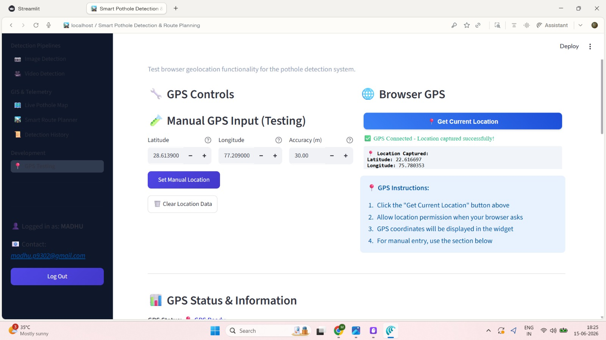
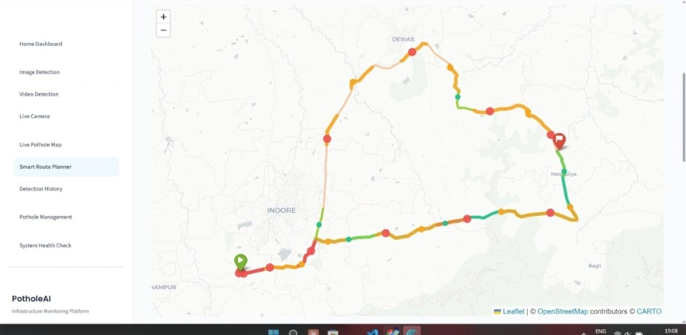

# Potholes Detection System with Real-Time Mapping

## About the Project

Road potholes are a common problem that can damage vehicles and make travelling unsafe. Finding potholes and keeping track of their locations can help identify roads that need maintenance.

The Potholes Detection System with Real-Time Mapping is a Python-based web application that uses computer vision to detect potholes in road images and videos. It combines pothole detection with location tracking, an interactive map, and route planning to help users explore reported road hazards.

The project uses YOLOv11 for object detection and Streamlit for the web interface. Detected potholes and their associated location information can be stored in a local SQLite database and displayed on an interactive map.

The system is intended to support road monitoring across India, depending on the availability of location, map, and routing services.

## Features

### 1. Image-Based Pothole Detection

- Upload road images for pothole detection.
- Run the configured YOLO model on the uploaded image.
- Display available detection bounding boxes and confidence scores.
- Associate detection results with location information where available.

### 2. Video-Based Pothole Detection

- Upload road videos for frame-by-frame analysis.
- Process video frames using the configured detection model.
- Display pothole detections on processed frames.
- Review the resulting detection output.

### 3. Live Camera Detection

- Use browser camera input through WebRTC where supported.
- Process camera frames using the configured detection pipeline.
- Display available pothole detection results.
- Camera functionality depends on browser permissions and network connectivity.

### 4. GPS and Location Integration

- Select a location manually on the map.
- Search for locations using the configured geocoding service.
- Capture browser GPS coordinates when permission is granted.
- Read GPS metadata from supported images when available.
- Store supported location and detection details in the database.

### 5. Interactive Pothole Map

- Display recorded pothole locations on an interactive map.
- Explore reported road hazards geographically.
- View available information associated with recorded detections.
- Use OpenStreetMap-based mapping through Folium.

### 6. Smart Route Planner

The Smart Route Planner uses the OSRM routing service to retrieve available driving routes between a starting point and a destination.

The application can compare available routes against pothole records stored in its database. Route-risk scores are calculated using the project's configured logic, helping users understand the recorded pothole risk along available routes.

The results depend on the routes returned by the routing service and the pothole data available in the database.

### 7. Dashboard and Detection History

- View project statistics on the dashboard.
- Review previously stored detection records.
- Access available detection and management pages.
- Check selected dependencies and application resources through the System Health page.

### 8. Pothole Management

The management interface provides access to stored pothole records and supported status updates. The available operations depend on the current application implementation.

## Application Screenshots

### Smart Route Planner

The Smart Route Planner displays a route on an interactive map. Different route segments are visualized with colors to help users inspect the selected route.



### GPS Integration

The GPS interface supports browser-based location capture and manual coordinate input for testing location functionality.




## Technology Stack

| Component | Technology |
|---|---|
| Programming Language | Python |
| Web Framework | Streamlit |
| Object Detection | Ultralytics YOLOv11 |
| Image Processing | OpenCV, Pillow |
| Data Processing | Pandas, NumPy |
| Data Visualization | Plotly |
| Database | SQLite |
| Interactive Mapping | Folium, Streamlit-Folium |
| Map Data | OpenStreetMap |
| Geocoding | Nominatim, where configured |
| Route Planning | OSRM |
| Live Camera | Streamlit-WebRTC, PyAV |

## Project Structure

The repository contains the Streamlit entry point, page modules, utility code, database-related files, model and dataset artifacts, and supporting resources.

```text
Potholes_detection_with_real_time_mapping/
│
├── app.py
├── requirements.txt
├── pages/
├── utils/
├── assets/
├── database/
├── screenshots/
├── pothole.v18i.yolov11/
├── runs/
├── train.py
└── yolo11n.pt
```

The structure shown above is a simplified overview. Refer to the repository for the complete list of files and directories.

## Installation and Setup

### Prerequisites

- Python 3.11 recommended for the current dependency configuration
- Git
- A modern web browser
- Internet access for external map, geocoding, and routing services

### Step 1: Clone the Repository

```bash
git clone https://github.com/Madhu9302/Potholes_detection_with_real_time_mapping.git
cd Potholes_detection_with_real_time_mapping
```

### Step 2: Create a Virtual Environment

On Windows, run:

```powershell
python -m venv venv
```

Activate the environment:

```powershell
.\venv\Scripts\Activate.ps1
```

If PowerShell blocks environment activation, you can temporarily allow it for the current terminal:

```powershell
Set-ExecutionPolicy -Scope Process -ExecutionPolicy RemoteSigned
.\venv\Scripts\Activate.ps1
```

### Step 3: Install Dependencies

```powershell
python -m pip install --upgrade pip
python -m pip install -r requirements.txt
```

### Step 4: Run the Application

Run the following command from the project root:

```powershell
python -m streamlit run app.py
```

Open the local URL displayed in the terminal. Streamlit commonly uses:

```text
http://localhost:8501
```

If the port is already in use, Streamlit may select another available port.

## How the System Works

1. The user uploads an image or video, or selects the supported live-camera option.
2. The configured YOLO model processes the input and returns available pothole detections.
3. The application displays the detection results.
4. Location information is selected, captured, or extracted through the supported location methods.
5. Supported detection and location details are stored in the SQLite database.
6. Recorded potholes can be displayed on the interactive map.
7. The route planner retrieves available routes and evaluates them against the pothole records stored in the database.

The results depend on the configured model, input quality, location data, database contents, and external services.

## Model and Detection Performance

The project uses the Ultralytics YOLO framework for object detection. The model weights configured in the application should be checked to confirm that they are suitable for pothole detection.

Detection performance can vary depending on road conditions, lighting, image resolution, camera angle, pothole size, and model training quality.

Confidence scores represent the model's confidence in individual detections; they do not represent the overall accuracy of the system. Precision, recall, and mean Average Precision (mAP) should be reported only after evaluation on labelled validation or test data.

## Location and Routing Services

The application relies on external services for some location and routing operations.

- **OpenStreetMap:** Provides map data used by the mapping interface.
- **Nominatim:** Supports location search where configured and available.
- **OSRM:** Provides driving routes where the routing service is reachable.
- **Browser GPS:** Requires browser support and user permission.

Search results, GPS coordinates, and route availability may vary. The application should not invent locations or route alternatives when the relevant service returns no results.

## Troubleshooting

### Streamlit command is not recognized

Activate the virtual environment and run:

```powershell
.\venv\Scripts\Activate.ps1
python -m streamlit run app.py
```

### Camera is not working

Check browser camera permissions and inspect the terminal for WebRTC errors. Live detection requires the camera feed to connect successfully before inference can be tested.

### No potholes are detected

Verify that the application loads the intended model weights and that the model is suitable for pothole detection. Test with known road images and review the inference settings and model evaluation results.

### Location search is not returning results

Check the internet connection and try a more specific location name. If search fails, use manual map selection if available.

### Route planning is unavailable

Check network connectivity and the availability of the configured OSRM service. Route comparison also depends on the pothole records stored in the database.

## Future Improvements

- Improve detection performance using additional labelled road images.
- Strengthen live-camera processing and duplicate-report prevention.
- Improve location search and suggestions across all detection pages.
- Expand pothole reporting and repair-status tracking.
- Develop separate dashboards for local users and civil authorities.
- Add jurisdiction-based report assignment and in-app notifications.
- Improve deployment and persistent storage for multi-user access.

These are potential improvements and should not be considered completed features unless they have been implemented and tested.

## Author

**Madhu Patel**  
B.Tech in Data Science
